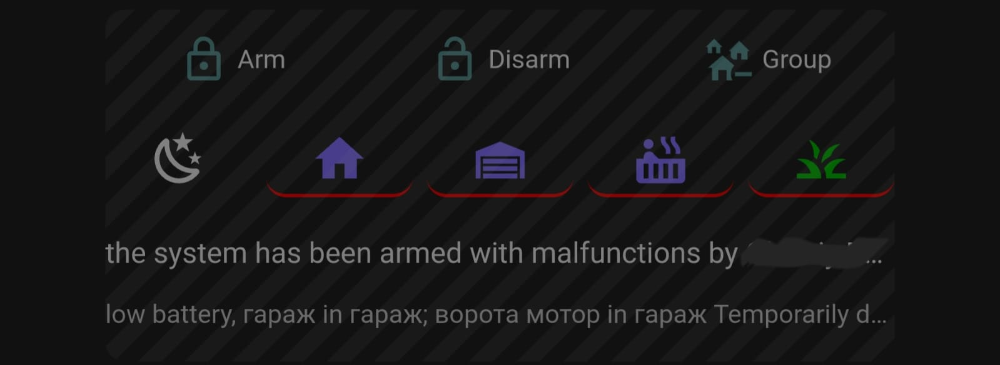

# Ajax Security via Jeedom Home Assistant Integartion

First HA Integration, that works!



Technically it uses Ajax API via Jeedom cloud. Jeedom works like a proxy. All commands and events exactly like in Ajax API documentation. This integartion call API and parse events independetly of Jeedom Ajax Plugin. It's provide more features and works much better.

# REQUIREMENTS
- Jeedom with exteral access by url (Jeedom cloud call this url on each Ajax Event)
- Jeedom Ajax System plugin. It's one time 8 euro. It opens access to Ajax API via Jeedom Cloud
- A simple code path to Jeedom installation.
- I do not add ajax@jeedom.com user to my hub (it's jeedom recommendation). Everything works withut this step.
  
!!! It's mandatory to have external access to Jeedom installation !!!

# What is works
- Arm, Force ARM, Disarm for HUB and Groups
- Build in HA Action (service) to Arm / Disarm multiple Groups with one click
- Optional HA User name instead of Ajax User in notifications
- Panic and muteFiredecetcors buttons
- Night Mode, Force Night Mode
- Correct malfunctions messages
- Detailed state for Arming and Disarming (good for HA UI) 
- Correct text Messages like in original APP
- Realtime events
- ALARM events
- Sensors with Real time updates for Door sensors, Temperature, PowerFailure, Battery charge, Online, GSM INfo, Masking, Relay voltage, and more..
- Relays, Sockets
- Relatime Events
- My [HA User Interface Card](https://github.com/bob-tm/ha_ajax_security/blob/main/ui/readme.md)
- Testing it limited to my equipment. Feedback is welcome!
  
# Installation
1. Install Jeedom + MQTT Manager + Ajax System Plugin.
2. Configure Ajax in Jeedom, Configure Mqtt in Jeedom to access mqtt server, that HA uses
3. It's not required to check "Transmit all equipment" in mqtt manager settings. Itegration do not use this information 
4. [Configure Jeedom by this Manual](https://github.com/bob-tm/ha_ajax_security/blob/main/jeedom/readme.md)
5. Install this integration using HACS
6. Configure access with information from step 4.
7. [Configure UI Card by this Manual](https://github.com/bob-tm/ha_ajax_security/blob/main/ui/readme.md)

   
## HACS Installation

1. Go to http://homeassistant.local:8123/hacs/integrations
1. Add `https://github.com/bob-tm/ha_ajax_security` custom integration repository
1. Go to http://homeassistant.local:8123/config/integrations and add new integration
1. Choose "Ajax Security via Jeedom" from the list and follow the config flow steps
3. Check checkbox to Enable Panic Button calls. Without checkbox calls will raise internals exception. Better to disable it while testing.

# Extending Manual
[How to add unsupported devices](https://github.com/bob-tm/ha_ajax_security/blob/main/extending.md)


## Outgoing requests through Jeedom Market

After restarting Home Assistant, use Reconfigure on the existing integration to
choose Installed Jeedom or Jeedom Market cloud. Existing entries keep using
installed Jeedom until reconfigured. MQTT reception remains on `jeedom/#`.

Market mode requires the cloud gateway authorization value (the SHA-512 of
`lowercase_market_username:SHA1(market_password)`, not the local plugin API key),
the external Jeedom base URL as Callback URL, and the Ajax System plugin API
key used to authenticate callbacks. Enter Ajax credentials to create a session;
the Ajax login and password are not stored. Session tokens are stored under
Home Assistant `.storage`; rejected authentication starts a reauthentication flow.
Do not share a refresh token with the installed Jeedom plugin.

The cloud gateway controls callback registration; verify incoming events still
arrive after signing in. Live gateway behavior has not been verified by unit tests.

## Local development API cache

Create `ajax_jeedom_dev.json` in the Home Assistant configuration directory:

```json
{
  "cache_api_requests": true
}
```

Reload the integration after changing the file. When enabled, existing JSON
responses in `.storage/ajax_jeedom/` are reused and per-device startup delays are
skipped. Missing responses are fetched from the API and saved as before. Commands
and event delivery are unaffected. Delete the file or set the value to `false`
to fetch fresh data. A missing or invalid file disables the development cache.
Keep this machine-specific file out of Git and production deployments.
